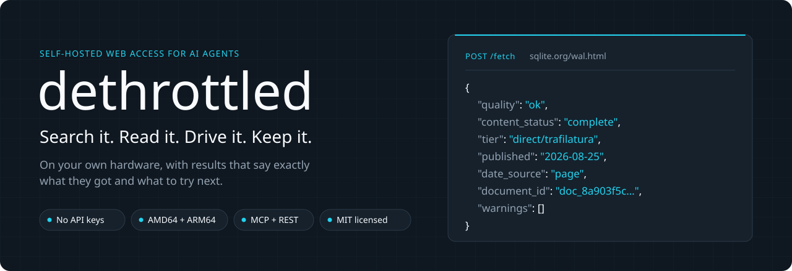
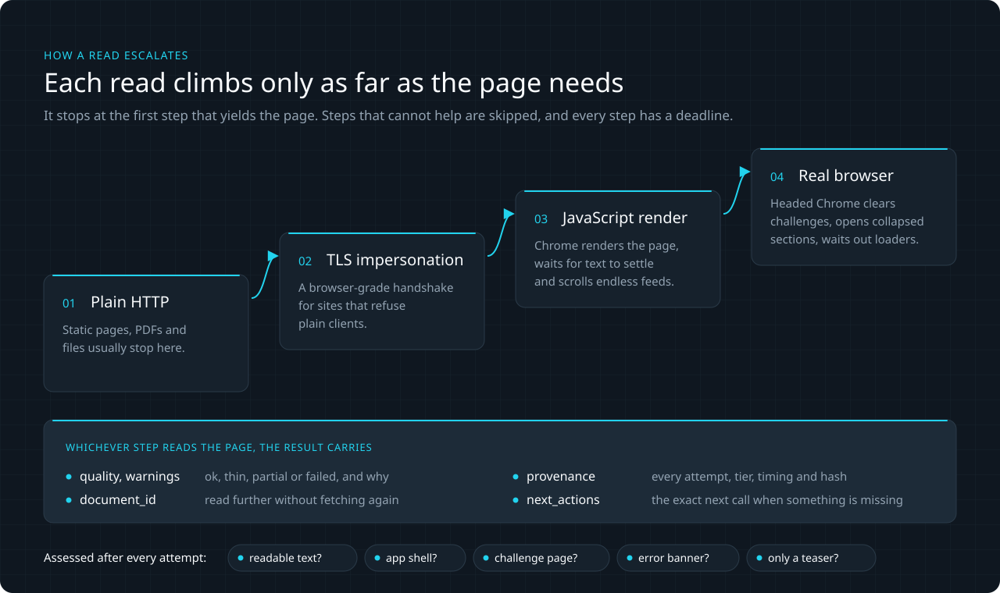

<p align="center">
  
</p>

<p align="center">
  <a href="https://pypi.org/project/dethrottled/"></a>
  <a href="https://github.com/halonyx-io/dethrottled/actions/workflows/ci.yml"></a>
  
  
  <a href="https://github.com/halonyx-io/dethrottled/blob/main/LICENSE"></a>
</p>

# dethrottled

**Self-hosted web access for AI agents. No API keys, no quotas, no per-call bill.**

dethrottled gives an agent, or your own scripts, the web: it searches several
engines, reads whatever the results point to (pages, PDFs, spreadsheets, slide
decks, scans, audio and video), drives a real Chrome when a site insists on one,
and keeps what it read so the next question starts where the last one stopped.
It runs in Docker on your own hardware, AMD64 or ARM64.

Every answer says how good it is. Results carry their quality, warnings,
completeness, dates and provenance, and when something is missing, the exact
next call to make. A failed or thin read is reported as one, never dressed up
as a success.

## Why dethrottled

- **Keyless, end to end.** Search, rendering, OCR, speech, embeddings and
  reranking run locally or against public pages. No account, key or paid
  service is needed; metered providers exist only as explicit opt-ins.
- **Search that keeps working.** When one engine blocks the server, the next one
  answers by itself, and every result lists the engines that found it.
- **Reads what simple scrapers can't.** Each read climbs only as far as the page
  needs: plain HTTP, TLS impersonation, a JavaScript renderer, a real browser.
  Sites with an official API (Stack Exchange, PubMed, GitHub, npm) are read
  through it instead.
- **Honest results.** `quality`, `warnings`, partial and truncated flags, attempt
  history, date sources and source hashes travel with the text.
- **Built for agents and scripts.** An MCP server and REST gateway with per-client
  tokens and scopes, an installable agent skill, a CLI, and responses sized for
  context windows: focused excerpts, token estimates and continuation handles.
- **It remembers.** Long documents are kept for follow-up reads, public evidence
  goes into a local searchable corpus for 90 days, and the server learns which
  read steps each site refuses.

## Quick start

You need Docker Engine with Compose.

```sh
git clone https://github.com/halonyx-io/dethrottled.git
cd dethrottled
docker compose up -d --build --wait
curl -fsS http://127.0.0.1:8787/health
```

The first build downloads Chrome, OCR data and local models, so it takes a
while. Then search:

```sh
curl -sS http://127.0.0.1:8787/v2/search \
  -H 'Content-Type: application/json' \
  -d '{"query":"sqlite write-ahead logging","limit":5}'
```

and read a page, keeping only the passages about one topic:

```sh
curl -sS http://127.0.0.1:8787/fetch \
  -H 'Content-Type: application/json' \
  -d '{"url":"https://sqlite.org/wal.html","focus":"checkpoint","max_chars":600}'
```

`/fetch` takes one page as `url` or up to ten as `urls`.

Prefer not to clone? With Python 3.10+ and Docker:

```sh
python3 -m venv .venv && . .venv/bin/activate
python -m pip install dethrottled
dethrottled stack up
dethrottled stack status
```

`dethrottled stack up` detects your CPU, memory, GPU, timezone and language, and
[Guided Setup](https://github.com/halonyx-io/dethrottled/blob/main/docs/GUIDED-SETUP.md) shows the plan before applying it.

> [!IMPORTANT]
> The raw API on `127.0.0.1:8787` has no authentication and is meant for the
> same machine. To serve other devices or a hosted agent, put the
> [authenticated REST and MCP adapters](https://github.com/halonyx-io/dethrottled/blob/main/docs/PUBLIC-ACCESS.md) in front of it.

## What it does

### Search

A search asks DuckDuckGo first. If it refuses, Yahoo's and then Bing's result
pages are read directly, then the browser tries DuckDuckGo, and Google in the
real browser is the last resort. Alongside that chain:

- **Yahoo's page** runs beside DuckDuckGo. It lists most of the same pages and
  shows their dates, so DuckDuckGo's results pick those dates up.
- **Yandex** (through a bundled SearXNG) and **Mwmbl** add results from indexes
  of their own. One of them follows every three primary results, so they are
  visible at small limits.
- The menu holds at most fifteen unique results. One page reached under several
  addresses comes back once, keeping everyone's dates and provenance, and
  `engines` lists every engine that found it.
- Google hides its links behind throttled redirects. When a destination cannot
  be resolved it is matched to another engine's copy (marked as inferred) or
  listed under `unresolved`; dethrottled never invents a URL.

| Profile | What it does |
|---|---|
| `web` (default) | The chain plus Yahoo, Yandex and Mwmbl, waiting at most 1 s for the extras |
| `fast` | One quick round: the chain plus Yahoo if it answers within 0.3 s, no reranking |
| `thorough` | Also Bing's page, and waits for every engine |
| `news` | Dated news engines first (DuckDuckGo News, Google News, Qwant News, Reuters, Bing News), freshest first |
| `academic` | Adds Crossref, OpenAlex and arXiv |

A local Ettin reranker refines the top of the list, and you can restrict,
exclude or prefer domains.

### Read almost anything

<p align="center">
  
</p>

After every attempt the result is assessed. Is there readable text? Is this an
app shell waiting for JavaScript, a challenge page, an error banner or a teaser?
A short page with no sign of JavaScript-built content is taken as it is; a
script shell goes on to the renderer. When a page needs more than rendering, a
read planner tries the fix it observed: scrolling a feed, expanding collapsed
sections, waiting out a loading state, or following the publisher's own
alternative format.

The same `fetch` call reads:

| Source | What you get |
|---|---|
| Web pages | Main text with title, publisher-declared dates and identifiers (DOI, ISBN, package versions) |
| PDF | Text layer, detected tables, page ranges and Tesseract OCR for scans; optional Docling layout analysis |
| Office and OpenDocument | DOCX, PPTX, XLSX, XLS, ODT, ODS, ODP, EPUB, RTF, legacy DOC/PPT, MSG and XLSB |
| Data and text | CSV and TSV row windows, JSON, XML, Markdown, plain text |
| Feeds | RSS and Atom as dated items, newest first |
| Archives and email | ZIP, TAR and GZIP members; EML messages and attachments |
| Media | Captions and subtitles, image OCR, and speech-to-text for audio and video with the optional speech worker |

### Drive a real browser

When reading isn't enough, `/drive` hands your agent a real Chrome session:
snapshot the page's controls, click, fill and submit forms, switch tabs and
frames, capture network responses, download files and take screenshots. Sessions
persist across calls, survive worker restarts through checkpoints, and stay
inside the hosts you allow.

```sh
curl -sS http://127.0.0.1:8787/drive \
  -H 'Content-Type: application/json' \
  -d '{"url":"https://example.com/","session":"demo","allowed_hosts":["example.com"],"steps":[{"action":"snapshot","limit":10}]}'
```

The browser runs as its own user behind a kernel firewall: it can reach public
addresses and nothing on your network. It uses your real GPU when one is
available, and your machine's timezone and language.

### Research in one call

`/research` takes a question, searches several angles, reads the most promising
sources in parallel and returns an evidence bundle: excerpts matched to your
question, with the gaps it could not cover. Mirrors and duplicate copies are
collapsed so the bundle contains distinct sources. No model writes an answer;
your agent does that with the evidence in hand.

```sh
curl -sS http://127.0.0.1:8787/research \
  -H 'Content-Type: application/json' \
  -d '{"question":"How does Python sqlite3 create an in-memory database?","max_sources":4}'
```

### Keep and reuse evidence

- **Retained documents.** Every read gets a `document_id`. Page through a long
  PDF, jump to a table's rows or view the source page as an image, without
  fetching it again.
- **A shared corpus.** Public reads are indexed in the background, lexically and
  with local MiniLM/E5 embeddings, and kept for 90 days. `corpus_search` finds
  passages across everything read before.

### Batches for scripts: DPR

[DPR](https://github.com/halonyx-io/dethrottled/blob/main/docs/DPR.md) is the lightweight path for lists of URLs: up to 500 per job from
a CSV or text file, lean 2,000-character rows by default, durable across
restarts, exported as JSONL, CSV or extracted files. `resolve` turns one search
into the first usable page. Five uncached pages take a few seconds.

### And more

- **Site mapping and crawling** within one site, with explicit page and path
  bounds.
- **Field extraction.** Named CSS selectors pull exact values out of a page
  without a model.
- **Ad and tracker blocking.** [HaGeZi Multi PRO](https://github.com/halonyx-io/dethrottled/blob/main/docs/ADBLOCK.md) filtering is on by
  default across every fetcher and browser.
- **Health you can read.** `/health` is liveness; `/ready` and `/v2/status` say
  `ok`, `degraded` (an engine was seen failing) or `initializing` (no search yet
  since start-up).

## What a result looks like

A real `fetch` response, trimmed:

```json
{
  "url": "https://sqlite.org/wal.html",
  "quality": "ok",
  "tier": "direct/trafilatura",
  "content_status": "complete",
  "page_type": "article",
  "published": "2026-08-25",
  "date_source": "page",
  "content": "In its default configuration, SQLite will checkpoint the WAL file at the conclusion of any transaction when the WAL file is more than 1000 pages long...",
  "content_chars": 30118,
  "truncated": true,
  "document_id": "doc_8a903f5c0b48492fb6fcf21d236245fc",
  "warnings": [],
  "tokens_estimated": 150
}
```

`truncated` is true because `focus` returned only the matching passages; the full
30,118-character text is kept under `document_id`. When a read is incomplete,
`workflow.next_actions` names the exact call to make next.

## Connect your agent

| You use | Connect with |
|---|---|
| An MCP client (Claude, Codex, Cursor and others) | The [MCP adapter](https://github.com/halonyx-io/dethrottled/blob/main/docs/PUBLIC-ACCESS.md): Streamable HTTP at `/mcp` with a bearer token |
| Your own code, remotely | The authenticated [REST gateway](https://github.com/halonyx-io/dethrottled/blob/main/docs/PUBLIC-ACCESS.md), same routes as the [HTTP API](https://github.com/halonyx-io/dethrottled/blob/main/docs/API.md) |
| Python | The [Python package](https://github.com/halonyx-io/dethrottled/blob/main/docs/PYTHON.md) |
| A coding agent that reads skills | The [agent skill](https://github.com/halonyx-io/dethrottled/blob/main/SKILL-dethrottled.md) and the [client playbook](https://github.com/halonyx-io/dethrottled/blob/main/docs/AGENT-PLAYBOOK.md) |
| A shell script | The `dethrottled` CLI and [DPR](https://github.com/halonyx-io/dethrottled/blob/main/docs/DPR.md) for batches |

## Honest limits

- Some sites block automated access whatever the client. Those reads fail, and
  say so.
- Search depends on upstream engines, which rate-limit, change their pages and
  sometimes answer bots with decoys. dethrottled rests an engine that refuses and
  moves on, but it cannot make an engine answer.
- Search dates come from what engines show: a provider's own date where there is
  one, otherwise a lead from the snippet, labelled as such. A result with no date
  shown has none.
- "Readable" is not "correct". OCR and speech can misread, and a page can be
  wrong. dethrottled reports evidence; it does not verify claims.
- The fetch ladder does not consult `robots.txt`. You are responsible for how you
  use it. Use the [authenticated adapters](https://github.com/halonyx-io/dethrottled/blob/main/docs/PUBLIC-ACCESS.md) and network
  isolation when anyone else can reach it.

## Documentation

| Start here | For |
|---|---|
| [Quick start](https://github.com/halonyx-io/dethrottled/blob/main/docs/QUICKSTART.md) | Install, first requests, everyday use |
| [Client playbook](https://github.com/halonyx-io/dethrottled/blob/main/docs/AGENT-PLAYBOOK.md) | How agents should call each tool and read each field |
| [HTTP API](https://github.com/halonyx-io/dethrottled/blob/main/docs/API.md) | Routes, examples and the [request reference](https://github.com/halonyx-io/dethrottled/blob/main/docs/HTTP-REFERENCE.md) |
| [Browser operation](https://github.com/halonyx-io/dethrottled/blob/main/docs/DRIVE.md) | Actions, sessions, scope, checkpoints and downloads |
| [Reading and evidence](https://github.com/halonyx-io/dethrottled/blob/main/docs/DEPENDABLE-WORKFLOWS.md) | Formats, OCR, layout, spreadsheets and continuation |
| [Configuration](https://github.com/halonyx-io/dethrottled/blob/main/docs/CONFIGURATION.md) | Workers, profiles, models and tuning |
| [Requirements](https://github.com/halonyx-io/dethrottled/blob/main/docs/REQUIREMENTS.md) | Hardware, memory and disk |
| [Operations](https://github.com/halonyx-io/dethrottled/blob/main/docs/OPERATIONS.md) | Upgrades, backups and releases |
| [All documentation](https://github.com/halonyx-io/dethrottled/blob/main/docs/README.md) | Everything else |

## Contributing

Read [AGENTS.md](https://github.com/halonyx-io/dethrottled/blob/main/AGENTS.md) before changing code. It sets out the rules
contributors (human or AI) follow here, and the checks a change must pass.

This checkout is **1.9.5**. A running service reports its own version at `/health`.

## License

dethrottled's own code is [MIT](https://github.com/halonyx-io/dethrottled/blob/main/LICENSE). The default Docker stack also runs
third-party software under its own licences: two AGPL-3.0 libraries in the API
image (PyMuPDF for PDFs, EbookLib for EPUB), SearXNG in its own container, and on
AMD64 Google Chrome in the browser worker, which is proprietary and downloaded
from Google when the image is built. Running it for yourself adds no
obligations. If you modify it and let other people use it over a network, or
redistribute the images, read [third-party notices](https://github.com/halonyx-io/dethrottled/blob/main/THIRD-PARTY-NOTICES.md) first.

Maintained by [Halonyx](https://github.com/halonyx-io)
