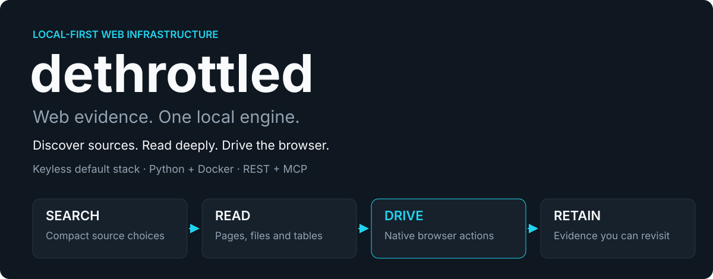
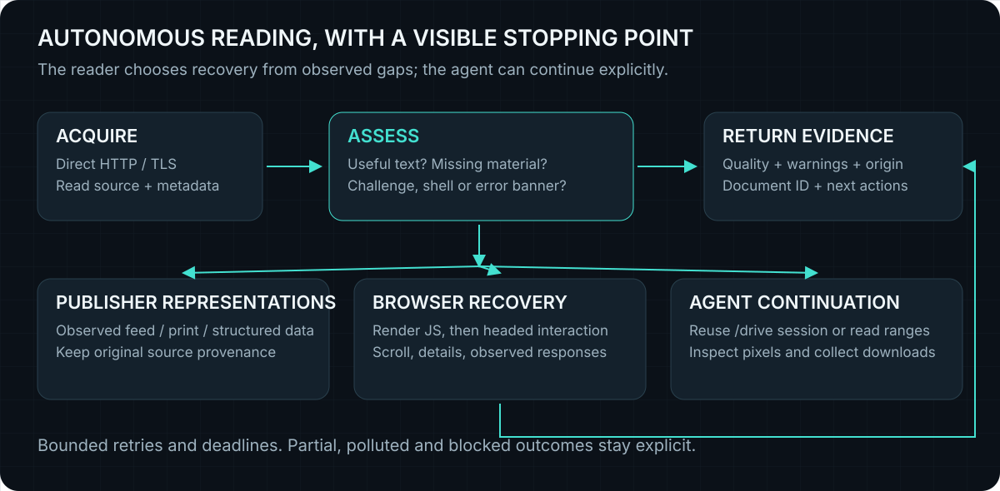
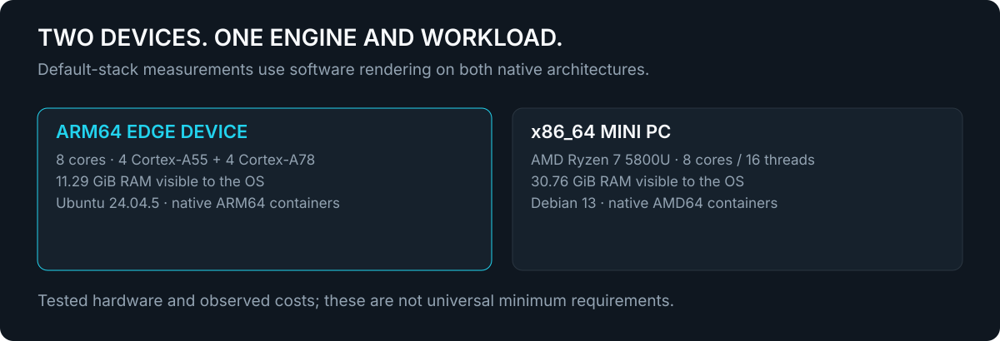
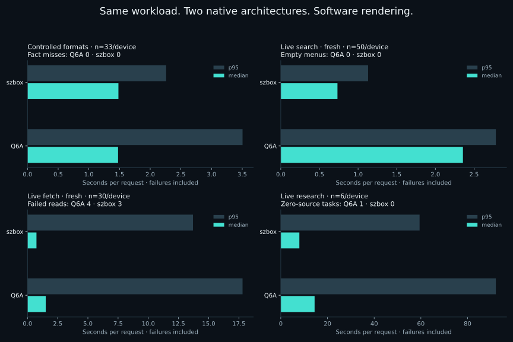

# Dethrottled

<picture>
  
</picture>

**Dethrottled is an open source, self-hosted web retrieval and evidence engine
for AI agents, applications and automation.** It discovers sources, reads pages
and files, operates a real browser, and retains evidence for follow-up.
It returns source references, warnings and concrete continuation steps. Your agent
or application decides what the evidence supports.

The default stack needs **no API key, paid search subscription or model API**.
It runs on native AMD64 and ARM64 Docker hosts. Public sites can still block
requests; retries, queues and storage have limits. Optional paid discovery
integrations remain opt-in and are not required by the default workflow.

For a first installation or ordinary script/HTTP use, start with the
[quick start](https://github.com/halonyx-io/dethrottled/blob/main/docs/QUICKSTART.md).

## Install the complete engine

Install [Docker Engine and Compose](https://docs.docker.com/engine/install/), then:

```sh
python3 -m venv .venv
. .venv/bin/activate
pip install dethrottled
dethrottled stack up
dethrottled stack status
```

The Python distribution includes matching deployment sources: **no Git clone is
needed**. `stack up` builds/downloads the five default services and waits for
readiness. Installing the package alone starts nothing and downloads no models.

```sh
dethrottled stack up --profile full  # add local speech and PDF layout workers
dethrottled stack down               # keep documents, cache and model volumes
```

Use `--project NAME --port PORT` for an isolated installation. Speech/layout model
weights initialize on first use; status reports this separately from readiness.
See [installation choices](https://github.com/halonyx-io/dethrottled/blob/main/docs/PYTHON.md)
and [measured requirements](https://github.com/halonyx-io/dethrottled/blob/main/docs/REQUIREMENTS.md).
Standalone Python/library use remains available, with capabilities determined by
its installed libraries, system tools and external workers.

Prefer a checkout? Both routes run the same default services:

```sh
git clone https://github.com/halonyx-io/dethrottled.git
cd dethrottled
docker compose up -d --build
```

The API listens on **`127.0.0.1:8787`**. Connect locally over REST, or configure the
optional [authenticated REST/MCP adapters](https://github.com/halonyx-io/dethrottled/blob/main/docs/PUBLIC-ACCESS.md)
for remote agents. The raw API has no caller authentication.

## Follow the evidence

| Capability | What the agent receives |
|---|---|
| Search | Compact source choices: up to ten DDG results, at most three per supplementary engine, fifteen unique URLs total |
| Read | Extracted pages, documents, tables, archives, captions and media; quality and provenance remain attached |
| Recover | Observed publisher alternatives, TLS acquisition, JavaScript rendering and scoped headed-browser interaction |
| Drive | Native controls, frames, tabs, application responses, downloads, screenshots and checkpointed sessions |
| Retain | Document IDs with text, page and table ranges; focused follow-up without fetching the source again |
| Remember | Public Corpus v2 with bounded lexical coverage, sampled semantic retrieval and explicit support/coverage metadata |
| Research | A bounded evidence bundle with explicit coverage gaps; ten sources by default, twenty on request |

<picture>
  
</picture>

A normal fetch runs the recovery policy automatically. When content remains
incomplete, `read_plan` and `workflow.next_actions` expose useful continuations,
including reuse of the same browser session. Agents can also operate `/drive`
directly. Read the [agent client playbook](https://github.com/halonyx-io/dethrottled/blob/main/docs/AGENT-PLAYBOOK.md)
for tool selection and response contracts.

```sh
curl -sS http://127.0.0.1:8787/fetch \
  -H 'Content-Type: application/json' \
  -d '{"urls":["https://docs.python.org/3/library/sqlite3.html"],"focus":"in-memory database"}'
```

Preserve `quality`, `warnings`, `source_partial`, `truncated`, `document_id` and
continuation metadata. A successful HTTP response is not proof of a complete,
relevant or correct read. OCR and speech may need checking against source pixels
or audio. Interactive challenges can remain unresolved.

## Reuse evidence across tasks

Corpus v2 retains eligible public passages for 90 days, with bounded SQLite
lexical indexing and representative MiniLM/E5 embeddings. Indexing runs in the
background; public document handles can be reopened across agent identities.
Private/authenticated reads are excluded from automatic sharing.

Standard retrieval checks source/model corroboration or meaningful query terms.
When evidence is missing, `support="broad"` exposes additional warned candidates,
including cross-language matches. Neither mode verifies an answer. The
[controlled evaluation](https://github.com/halonyx-io/dethrottled/blob/main/evaluations/corpus-v2/results/2026-11-05/REPORT.md)
records recovered facts and the precision/coverage tradeoff. See
[Corpus operation](https://github.com/halonyx-io/dethrottled/blob/main/docs/CORPUS.md)
for budgets, retention, migration and rollback.

## Measured on two machines

The [current installation and benchmark report](https://github.com/halonyx-io/dethrottled/blob/main/evaluations/install-showcase/results/2026-11-04/REPORT.md)
compares an ARM64 edge device with an x86_64 mini PC. It preserves
installation failures and fixes, controlled browser/document checks, 50 live
search questions, 30 fixed fetch targets and six research tasks per device.
Fresh acquisition, cache-enabled repeats and optional workers are reported
separately. Every plotted value is generated from retained case data.

<picture>
  
</picture>

| Recorded check | ARM64 edge device | x86_64 mini PC |
|---|---:|---:|
| Browser/document contracts, three runs | 63/63 | 63/63 |
| Controlled format fact retained, eleven fixtures × three runs | 33/33 | 33/33 |
| Worker-restart storage restoration | 3/3 | 3/3 |
| Nonempty live search menus | 50/50 | 50/50 |
| Fresh public fetches assessed `ok` | 26/30 | 27/30 |

The live `ok` label is the engine's assessment, not verified answer correctness.
The report separately records topic-marker retention, thin results and failures.

<picture>
  
</picture>

These are observed workloads, not universal minimum requirements or a paid-service
superiority claim. Earlier evaluations proved native Reddit interaction and
recovery on specific pages; Crunchbase and G2 remained blocked. Current live
outcomes, historical reports and limits are linked in the
[evidence index](https://github.com/halonyx-io/dethrottled/blob/main/docs/EVIDENCE.md).
Neural live-web reranking remains disabled.

## Explore the engine

| Guide | Purpose |
|---|---|
| [Documentation home](https://github.com/halonyx-io/dethrottled/blob/main/docs/README.md) | Find the right integration or operations guide |
| [Architecture](https://github.com/halonyx-io/dethrottled/blob/main/docs/PIPELINE.md) | Service boundaries, search, reading, research and corpus |
| [HTTP API](https://github.com/halonyx-io/dethrottled/blob/main/docs/API.md) | Routes, examples and generated request reference |
| [Browser operation](https://github.com/halonyx-io/dethrottled/blob/main/docs/DRIVE.md) | Actions, scope, sessions, checkpoints and downloads |
| [Requirements and measurements](https://github.com/halonyx-io/dethrottled/blob/main/docs/REQUIREMENTS.md) | Tested hardware, memory, disk and optional-profile costs |
| [Configuration](https://github.com/halonyx-io/dethrottled/blob/main/docs/CONFIGURATION.md) | Workers, models, profiles and workload controls |
| [Operations](https://github.com/halonyx-io/dethrottled/blob/main/docs/OPERATIONS.md) | Updates, backups, verification and remote deployment |

The default API image includes native document readers, Tesseract and MiniLM/E5
corpus models. Mutable evidence, jobs, cache and corpus use a named data volume;
browser checkpoints and optional model caches have their own volumes. GPU access
is optional. No `.env` file or worker URL is required for the default stack.

The fetch ladder does not consult `robots.txt`. Raw API access to trusted LAN
targets requires care; public adapters enforce narrower policies, alongside
operator-provided network isolation. See [operations](https://github.com/halonyx-io/dethrottled/blob/main/docs/OPERATIONS.md).

This checkout is **1.5.1**. Check `/health` and `/v2/capabilities` on the service you
actually use; deployed services and remote plugins can differ from a checkout.

[MIT license](https://github.com/halonyx-io/dethrottled/blob/main/LICENSE) · Maintained by [Halonyx](https://github.com/halonyx-io)
