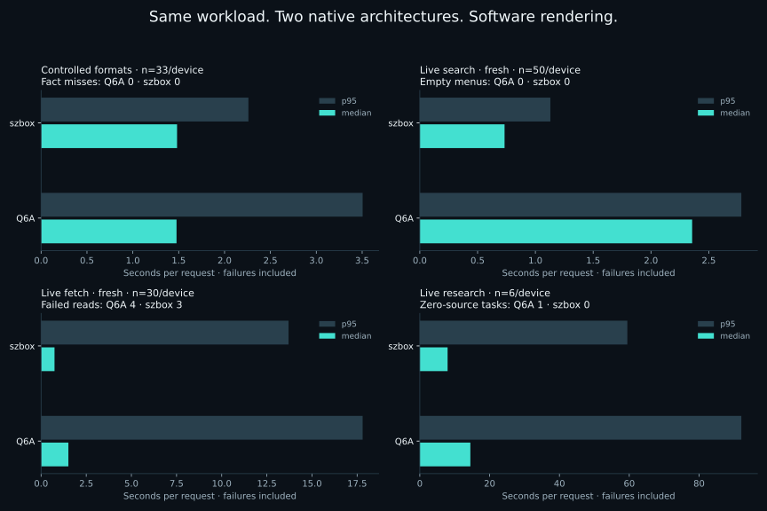
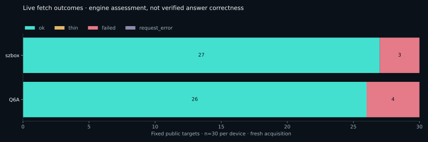
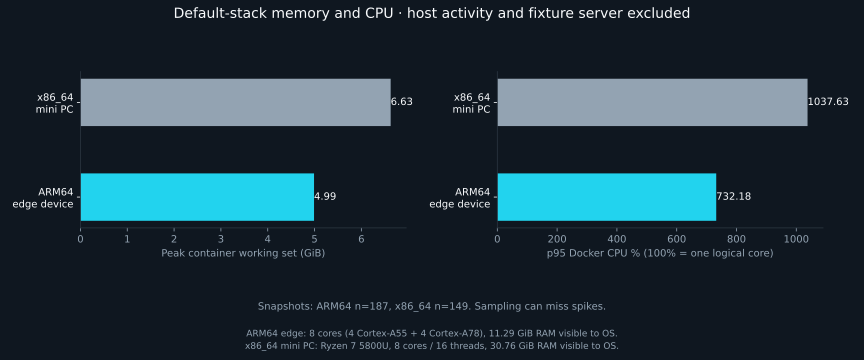

# Benchmarks and installation evidence

The current [1.4.0 two-device report](../evaluations/install-showcase/results/2026-11-04/REPORT.md)
compares the complete default stack on Radxa Dragon Q6A ARM64 and AMD Ryzen szbox.
It includes fresh Python/wheel installation, worker lifecycle, controlled facts,
live search/fetch/research, resource use and separate optional inference tests.

Read the report’s method before comparing devices: public sites change, host
services remain active, and cached responses differ from fresh acquisition.
HTTP success, engine quality labels and verified retained facts are separate.
Numerical figures are generated from retained JSON, with failed cases included.

- [Current report and raw evidence](../evaluations/install-showcase/results/2026-11-04/REPORT.md)
- [Installation and release verification](../evaluations/install-showcase/results/2026-11-04/PUBLICATION.md)
- [Reproducible protocol](../evaluations/install-showcase/README.md)
- [Tested requirements and profiles](REQUIREMENTS.md)
- [Historical 4 October comparison](BENCHMARKS-2026-10-04.md)
- [Other dated evaluations](EVIDENCE.md)
