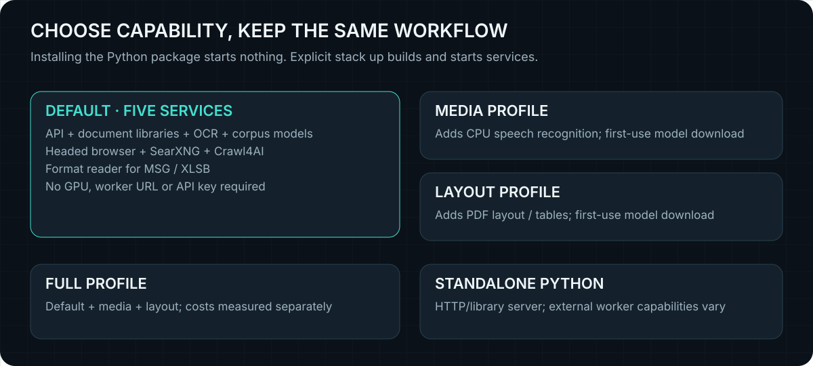

# Configuration

[Guided Setup](GUIDED-SETUP.md) recommends Docker worker and inference settings
and saves them as a reviewable Compose override.

<picture>
  
</picture>

Base Compose runs the API, DNB browser, SearXNG and the MSG/XLSB format reader.
DNB handles browser discovery, JavaScript rendering and interaction. Optional profiles add local speech and PDF layout.
Authenticated remote adapters are a separate overlay. The API image already contains native readers, Tesseract and
corpus weights; a source install requires explicit dependencies and setup.

Ettin is enabled by default in both Compose installation paths. Set
`DETHROTTLED_RERANK=0` to opt out before starting either stack. The API seeds its
project cache on first startup. Search retains its prior
ordering if the model is unavailable or cannot score the full batch. The
`ranking` trace records `neural_rerank_unavailable` or `neural_rerank_fallback`.
By default the first-stage winner keeps its slot and Ettin orders positions
two and three. `first_stage_lead_retained` records that policy. Raw
`neural_score` is available on scored rows, and provider positions remain
available for diagnostics.
The API uses the FP32 ONNX export with ONNX Runtime's CPU provider and applies
the published Ettin scoring head in FP32. REST and MCP forward the API's
scores and ordering. The Compose and managed-stack paths accept the same
token, character, depth and thread settings.

## PyPI-managed installation

After `pip install dethrottled`, use `dethrottled stack up` to start the complete
default stack without a Git clone. Docker Engine and Compose are prerequisites.
See [Python installation and worker management](PYTHON.md) for profiles, state
locations and lifecycle commands.

## GitHub base installation

```sh
docker compose up -d --build
```

No `.env` file is required. Copy `.env.example` only to override defaults.
`.env` is Compose interpolation, not an automatic container environment export.
Only names mapped by the selected Compose files reach their services. Other
application settings need an `environment` entry in a local override. Inspect
`docker compose config` locally; its output can contain secrets.

| Interpolated name | Default | Purpose |
|---|---|---|
| `DETHROTTLED_AUTO_WORKERS` | `1` in Compose | Discover started local speech/layout/format workers; explicit URLs or `off` take precedence |
| `DETHROTTLED_BIND`, `DETHROTTLED_PORT` | `127.0.0.1`, `8787` | Host API publication |
| `CRAWL4AI_TOKEN` | `dethrottled-compose-local` | Private renderer credential, not caller authentication |
| `CRAWL4AI_ALLOW_INTERNAL_URLS` | `false` | Renderer access to private addresses |
| `DETHROTTLED_CHEAP_DISCOVERY` | `1` in Compose | Static DDG Lite probe before browser fallback; standalone default 0 |
| `DETHROTTLED_MULTILINGUAL_CORPUS` | `1` in Compose | Enable E5 alongside MiniLM; standalone opt-in |
| `DETHROTTLED_EXTRACT_CACHE_CHARS` | `4000000` | Retained extraction budget. It exceeds the 1,000,000-character response limit so a long source (a whole book, a large specification) stays retained: continue with `read_document` at `next_offset`. Text clipped at this budget is reported as partial (`partial_reason: extraction_cache_limit`). |
| `DETHROTTLED_CRAWL4AI_BUDGET` | `-1` | No hourly renderer quota; 0 disables; positive values cap/window |
| `DETHROTTLED_RENDER_CONCURRENCY` | `2` | Active render work at the API and DNB. Base Compose passes the same setting to both. |
| `DETHROTTLED_HEADED_SETTLE` | `1` | API: after a headed read's first capture, take a second, settled look (network quiet, scroll until stable) and keep it only when it reads more; `0` disables it |
| `DNB_NETWORK_SETTLE_SECONDS` | `3` | DNB render: wait at most this long for the page to settle (network idle, or stable visible text) before capture, within the render budget. `0` disables it. Set on the DNB service. |
| `DNB_SCROLL_MAX_ADDED_CHARS` | `50000` | DNB render and `settle`: stop scrolling once this much text has been added (endless feeds). A round that adds height but less than `DNB_SCROLL_MIN_TEXT_GROWTH` characters (lazy images) also ends scrolling. Pages whose single `<article>` holds most of the text are not scrolled. |
| `DNB_SCROLL_MIN_TEXT_GROWTH` | `100` | Characters of new visible text a scroll round must add for scrolling to continue. |
| `DNB_SETTLE_STABLE_SECONDS` | `0.6` | DNB render and `settle`: readiness ends at network idle, or once visible text of at least `DNB_SETTLE_MIN_TEXT` characters has not changed for this long, whichever comes first (still bounded by `DNB_NETWORK_SETTLE_SECONDS`). |
| `DNB_SETTLE_MIN_TEXT` | `500` | Visible characters below which a page is treated as still loading and keeps waiting for network idle. |
| `DNB_SCROLL_ROUNDS`, `DNB_SCROLL_PAUSE_SECONDS` | `10`, `0.6` | DNB render: scroll to the end until the document stops growing, within the render budget, so infinite-scroll pages load later items. A page that does not grow costs one pause; endless feeds return larger text. `0` rounds disables it. Set on the DNB service. |
| `DETHROTTLED_DRIVE_SESSION_TTL`, `DETHROTTLED_DRIVE_MAX_SESSIONS` | `1800`, `8` | Browser session expiry and capacity |
| `DETHROTTLED_READ_SESSION_IDLE_SECONDS` | `300` | Close an automatic read's browser page after this long unused (0 = use the session TTL), including a page handed over as `read_plan.browser_session`. Reads that finish without recovery close their page at once and keep cookies and storage in a checkpoint; under memory pressure the renderer closes idle read pages before refusing work. Named `/drive` sessions are unaffected |
| `DETHROTTLED_RENDER_BUSY_RETRY_MAX`, `DETHROTTLED_RENDER_BUSY_REST` | `2`, `15` | When the renderer refuses a read for capacity (memory, queue, slots) and asks to retry within this many seconds, retry once; if still refused, pause rendering this many seconds without the escalating cooldown. Unnamed 429/503 and connection failures keep `DETHROTTLED_TIER_COOLDOWN` |
| `DETHROTTLED_BROWSER_GRAPHICS` | `auto` in Compose | Verify exposed hardware through GL EGL, fall back to software; `mesa` retains GL, `default` retains original args |
| `DETHROTTLED_READ_PLAN_SECONDS` | `30` | Additional recovery admission budget, clamped to 0–120; in-flight operations retain their transport timeout |
| `DETHROTTLED_USER_AGENT` | `dethrottled/<version> (+project URL; automated fetcher)` | Article-fetch identity; empty or unset uses the default |

The base file maps internal worker URLs and optional worker/key variables.
The complete interpolation map is in `docker-compose.yml` and the agents overlay;
this table covers the main controls. Keep mutable data in named volumes. Do not
point the model directory at an empty mounted path that hides the baked weights.

Component settings are not Compose interpolation; set them on the named service
through a local override:

| Name | Default | Applies to |
|---|---|---|
| `DETHROTTLED_CACHE_MAX_BYTES` | `536870912` | API: cache footprint ceiling; oldest rows are evicted past 90% and compacted |
| `DETHROTTLED_CACHE_MAINTENANCE_EVERY` | `200` | API: writes between expiry/size maintenance runs; `0` disables automatic runs |
| `DETHROTTLED_BROWSER_IDLE_SECONDS` | `300` | browser worker: close the separate crawl browser when idle; `0` keeps it warm |
| `DETHROTTLED_MEMORY_PRESSURE` | `1` | browser worker: ask Chrome to release caches after crawl/drive; `0` disables |
| `MCP_TOOL_PROFILE` | `full` | MCP adapter: `core` exposes six high-use tools; `full` exposes all 20 |
| `DETHROTTLED_SEARCH_FANOUT` | `0` | API: one extra intent-aware query variant; extra upstream requests |
| `DETHROTTLED_RERANK` | `1` in Compose, `0` in standalone Python | API: use the local Ettin 68M fp32 ONNX reranker when `DETHROTTLED_RERANK_MODEL` is set |
| `DETHROTTLED_RERANK_MODEL` | empty | Directory produced by `scripts/fetch-rerank-model.sh`: Ettin 68M fp32 `model.onnx`, `tokenizer.json`, `config.json` and the `2_Dense`/`3_LayerNorm`/`4_Dense` modules |
| `DETHROTTLED_RERANK_MAX_TOKENS` | `512` | Tokenizer truncation length, clamped to the model maximum |
| `DETHROTTLED_RERANK_TEXT_CHARS` | `3000` | Characters of labelled title, URL and snippet or passage before token truncation |
| `DETHROTTLED_RERANK_DEPTH` | `3` | Shortlist depth including any protected first slot. Candidates beyond it retain first-stage order. |
| `DETHROTTLED_RERANK_KEEP_FIRST` | `1` | Protect the first-stage winner. Set to `0` to let Ettin order the entire shortlist. |
| `DETHROTTLED_RERANK_THREADS` | `8` | ONNX CPU threads for reranking; the tested configuration |
| `DETHROTTLED_SEMANTIC_CACHE` | off | API: `1` or a SQLite path enables the separate paraphrase cache |
| `DETHROTTLED_SEMANTIC_CACHE_THRESHOLD` | `0.55` | MiniLM cosine threshold; tune only with a labelled paraphrase set |
| `DETHROTTLED_SEMANTIC_CACHE_TTL` | `21600` | Seconds before a semantic cache entry is ignored |
| `DETHROTTLED_SEARCH_PROFILE` | off | Browser worker: `1` or a path persists search cookies/localStorage |
| `DETHROTTLED_SEARCH_PROXIES` | empty | Comma-separated provider proxies; round-robin per search call |
| `DETHROTTLED_<PROVIDER>_API_KEYS` | empty | Comma-separated keys for `exa`, `tavily` or `parallel`; legacy single key still works |

## Automatically connected local workers

The format reader starts by default. Speech and layout inference stay optional
because their model downloads and memory requirements differ from ordinary web
reading. Enable either, or both with the `full` profile:

```sh
docker compose --profile full up -d --build
```

Use `--profile media` or `--profile layout` for just one. The API discovers those
fixed service names through Docker DNS; no extra URLs or core restart are needed.
Discovery misses are cached for ten seconds. Capabilities and `/v2/status` reflect
what is present. `DETHROTTLED_AUTO_WORKERS=0` disables discovery. An explicit worker
URL takes precedence; `off` disables one reader even when its service is running.
Source installs do not discover network services unless explicitly enabled.

| Worker | Defaults and prerequisites |
|---|---|
| Media | Faster-Whisper `small`, CPU int8, 3 GiB container cap, one active conversion, 50 MiB input, 30 minutes audio, 570-second supervisor deadline; cached weights in media-models |
| Layout | Docling 2.145.0/CPU PyTorch, 8 GiB/four CPUs, one active conversion, 50 MiB, up to 100 selected pages, 180-second deadline; layout-models volume |
| Formats | Tika 3.3.3 for MSG/XLSB only, 2 GiB/two CPUs, 1 GiB Java heap, 50 MiB, one conversion, 60-second deadline |

Media/layout can need an initial model download. Their `/ready` and `/metrics`
are private; `/v2/status.workers` probes them with a ten-second cache. An unready
worker with `initialization=first_use_download` is waiting for its first model
download; the requested conversion initiates it without a key. Cancellation
or deadline kills and reaps supervised conversion children before releasing
admission. Reloading models per job can increase latency. Optional workers have
resource caps; the base API/browser services have no explicit Compose CPU quota
or overall memory cap. `shm_size` is not a total RAM limit.

`WHISPER_MODEL` and `MEDIA_MAX_SECONDS` are mapped by the media overlay. Larger
speech models need separate memory/quality measurements. The [1.4.0 evaluation](../evaluations/install-showcase/results/2026-11-04/REPORT.md)
exercised both inference workers on AMD64 and ARM64 with fixed fixtures. That
does not certify arbitrary documents, longer audio or every graphics profile.

## Corpus models

MiniLM and E5 are corpus retrievers, not live-web neural rerankers. E5 uses a
separate model-versioned index and reciprocal-rank fusion. MiniLM's floor is
0.22; E5's is 0.77. These are calibrated retrieval cutoffs, not truth scores.
`DETHROTTLED_EMBED_THREADS` defaults to 4. A supervised backfill resumes committed
progress on schema 1; check `/v2/status.multilingual_backfill`. [Corpus v2](CORPUS.md) uses its durable queue instead and exposes it
under `/corpus/stats.index`. Disabling E5 preserves MiniLM. Schema 2 supports
conservative `support=standard` retrieval and warned `support=broad` candidates;
the latter retains useful single-model multilingual matches at a precision cost.

For source installs, use `pip install '.[all]'` and
`./scripts/fetch-models.sh --multilingual`, then set the printed model/revision
variables. Optional extras do not start Docker workers. See [Python](PYTHON.md).

## Application workload controls

These process settings need explicit Compose mappings/overrides when not already
mapped. Change them against recorded coverage and failure cases, not just latency.

| Variable | Default | Meaning |
|---|---|---|
| `DETHROTTLED_BROWSER_RECOVERY` | `auto` | Browser worker: observed host-scoped navigation recipes and bounded readiness; `off` disables them. Forwarded by base Compose. |
| `DETHROTTLED_THIN_CHARS` | `600` | HTML threshold; structured short documents differ |
| `DETHROTTLED_SHELL_MAX_TEXT`, `DETHROTTLED_SHELL_HTML_RATIO` | `2048`, `20` | A direct/TLS HTML read with less text than this and at least this many HTML bytes per text character is an application shell: it is kept only as a fallback and rendering tiers are tried |
| `DETHROTTLED_PAGE_BUDGET`, `DETHROTTLED_PAGE_BUDGET_BULK` | `60`, `25` seconds | Soft ladder budgets; a known recovery case can receive a bounded headed attempt afterward |
| `DETHROTTLED_CONNECT_TIMEOUT` | `2` seconds | Direct/TLS connection establishment per attempt/address; does not shorten direct response reads. Resolver time and multiple addresses can exceed this; workers retain their own deadlines. |
| `DETHROTTLED_TLS_TIMEOUT` | `8` seconds | TLS streaming low-speed allowance; its connect allowance is bounded by `DETHROTTLED_CONNECT_TIMEOUT`. |
| `DETHROTTLED_CRAWL4AI_TIMEOUT`, `DETHROTTLED_CRAWL4AI_RENDER_MS` | `25` seconds, `20000` ms | Renderer transport/browser timing |
| `DETHROTTLED_RENDER_MAX_WAITING`, `DETHROTTLED_RENDER_PER_CLIENT` | `32`, `8` | Renderer waiting bounds |
| `DETHROTTLED_RENDER_QUEUE_SECONDS` | `60` | Renderer admission wait |
| `DETHROTTLED_HEADED_QUEUE_SECONDS` | `60` | Headed admission wait; one active, 32 total/eight per caller waiting |
| `DETHROTTLED_CHALLENGE_WAIT_SECONDS` | `15` | Headed polling deadline, separate from queue and request timeouts |
| `DETHROTTLED_MAX_HTML_BYTES`, `DETHROTTLED_PDF_MAX_BYTES`, `DETHROTTLED_DOC_MAX_BYTES` | 10,000,000; 25 MiB; 50 MiB | Input limits |
| `DETHROTTLED_OCR_PAGE_CAP`, `DETHROTTLED_OCR_PAGE_TIMEOUT` | `8`, `30` seconds | OCR work bounds |
| `DETHROTTLED_OCR_THREADS` | Embedding-thread setting, then visible CPUs | API-side Tesseract threads per process. Guided Setup writes this independently in its Compose override. |
| `DETHROTTLED_DOC_MAX_ROWS`, `DETHROTTLED_DOC_MAX_CELL` | `2000`, `32767` | Table window/cell defaults; request overrides remain bounded |
| `DETHROTTLED_CORPUS_MAX_PASSAGES`, `DETHROTTLED_CORPUS_RETENTION_DAYS` | `50000`, `90` | Corpus retention; cache lifetimes unchanged |

Mesa exposes its actual llvmpipe software renderer. It needs no GPU passthrough,
fingerprint injection or unsafe SwiftShader opt-in. Graphics-heavy sites can use
more CPU; select `default` if the compatibility override causes trouble.

## Remote access and external options

Use [public adapters](PUBLIC-ACCESS.md) for remote authentication, namespace and
admission setup. Base Compose does not install a reverse proxy or public TLS.
The [HTML-to-PDF overlay](PDF_WORKER.md) is separate and currently publishes host
port 8788 on all interfaces.

Optional `DETHROTTLED_EXA_API_KEY`, `DETHROTTLED_TAVILY_API_KEY` and
`DETHROTTLED_PARALLEL_API_KEY` stay server-side and require explicit `engines`
selection. Default profiles never spend them. No model API is required for the
standard workflow. The fetch ladder ignores robots.txt but retains local
pacing, deadlines and storage limits.

[Documentation home](README.md) · [Agent guide](AGENT-UPGRADES.md) · [API](API.md) · [Evidence](EVIDENCE.md)

[Corpus v2](CORPUS.md) documents separate harvest, lexical,
semantic, database and matrix budgets, public eligibility, migration and rollback.

## Ad/tracker filtering

`DETHROTTLED_ADBLOCK=1` is the default; `0` disables filtering
and updates across managed workers. See [coverage, diagnostics and limitations](ADBLOCK.md).
