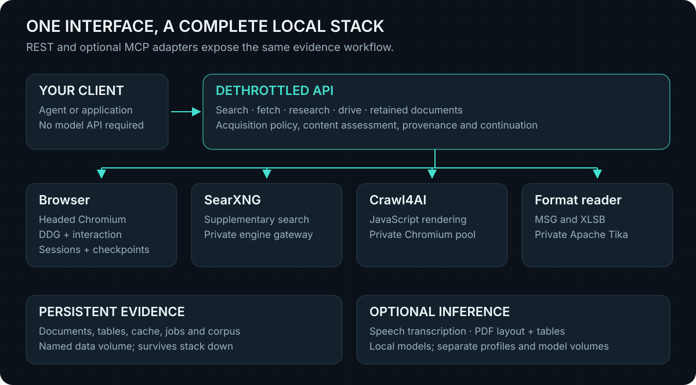

# Architecture and data flow

<picture>
  
</picture>

Dethrottled separates discovery, reading, browser operation and evidence storage.
The API can run alone with reduced capabilities; full Compose provides the local
browser and renderer paths.

```text
agent / application
  -> local HTTP API, or optional authenticated REST/MCP adapter
       -> discovery: headed DDG/Bing worker, keyless web/news/academic sources
       -> read: direct HTTP -> TLS -> Crawl4AI -> conditional headed browser
       -> operate: stateful headed browser /drive
       -> parse: local readers, OCR, default format and optional speech/layout workers
       -> retain: versioned documents, source bytes where available, read jobs
       -> retrieve: SQLite cache and separate MiniLM/E5 corpus indexes
```

## Discovery

Known-source text reads add an [observed-gap recovery loop](READ-PLANNER.md) after
the transport ladder. Publisher-declared primary representations and bounded
browser inspection/actions are reassessed before adoption. Trace metadata records
the chosen strategy, reason and result; partial evidence survives failed recovery.

Compose enables a bounded static DDG Lite probe before the headed browser race.
On challenge, poor results or transport failure it falls through to the existing
Patchright worker. The worker races DDG Lite and DDG HTML in separate tabs
with shared pacing, three active searches and bounded waiting. A usable race
winner needs real result URLs and useful text, not just HTTP 200. Direct keyless
DuckDuckGo is the default direct fallback. All DDG acquisition paths share ten
choices, with no automatic pagination; deliberate supplementary sources have
three choices each, six total, and the complete unique menu defaults to and is capped at fifteen.

Normal web/balanced profiles acquire DDG and separate first-page Yahoo/Yandex
supplements concurrently; source order is preserved and novel supplements alternate.
Fast is DDG-only. Thorough adds Mwmbl; academic adds specialist sources. News uses RSS and the
configured SearXNG news engines; academic can add Crossref, OpenAlex and arXiv.
Explicit engines can select optional metered providers only when configured.
URL deduplication merges provenance; identical titles alone do not remove
independent URLs. Lexical ranking/fusion and optional stored-corpus candidates
operate before selected sources are fetched. Research can remove near-duplicate
source content after acquisition. Research admits at most 24 unique candidates
across facets, reads ten sources by default, and allows twenty when requested.

## Acquisition and parsing

The normal ladder is direct HTTP, Chrome-like TLS through curl_cffi, Crawl4AI,
then conditional reuse of the headed browser. Jina is an optional external tier,
disabled in Compose. Rendering restrictions override automatic escalation.
Challenges and nearly empty script/iframe shells can reach the headed tier
without a caller knowing its expert flag. A one-slot fair queue preserves
competing reads; caller/exact-host/policy-scoped sessions retain clearance.

The automatic headed reader inspects after document commitment and polls
interstitials or empty loading documents within a bounded deadline. Ordinary
drive navigation waits for DOMContentLoaded. Partial or clipped snapshots remain
explicitly partial. Navigation/response errors are not converted into useful
content. Cookies are not promoted into the TLS tier or shared between callers.

Reliable byte signatures precede MIME/URL hints for documents. HTML uses the
trafilatura/resiliparse/selectolax cascade. Structured readers preserve page/row
provenance and have a different short-content floor from articles. OCR, captions,
speech, layout inference and Tika fallback disclose their method and limits.
See [reading and evidence](DEPENDABLE-WORKFLOWS.md).

## Evidence and continuation

The extraction cache, retained documents, retained source bytes and corpus serve
different purposes. A clipped response can reopen a retained document without a
new fetch. Reparse or pixel inspection needs retained source bytes, or a
hash-verified reacquisition; changed bytes are not silently substituted.
Jobs retain committed rows across disconnects and expose explicit resume rules.

Research collects sources, term-matched evidence windows and a coverage ledger.
It does not call a language model or verify an answer. Browser actions are a
separate interaction surface with a durable operation journal; unknown external
mutation outcomes are not automatically replayed.

## Corpus and state

MiniLM and multilingual E5 use separate versioned 384-dimensional indexes and
relevance floors. E5 prefixes queries/passages and fuses retrieval with MiniLM;
FTS5 supports lexical and opaque-identifier lookup. Compose enables E5 and a
supervised backfill child. Embedding work is asynchronous; no live-web neural
reranker or external model service is required.

The API image contains pinned model weights under `/opt/dethrottled/models`.
`/data` holds mutable cache, corpus, documents, source files and jobs. Browser
checkpoints and operation history use the separate browser-state volume.
Optional speech/layout weights have their own persistent volumes. Public
adapters share token hashes and admission state outside the raw API.

[Documentation home](README.md) · [Agent guide](AGENT-UPGRADES.md) · [API](API.md) · [Evidence](EVIDENCE.md)
