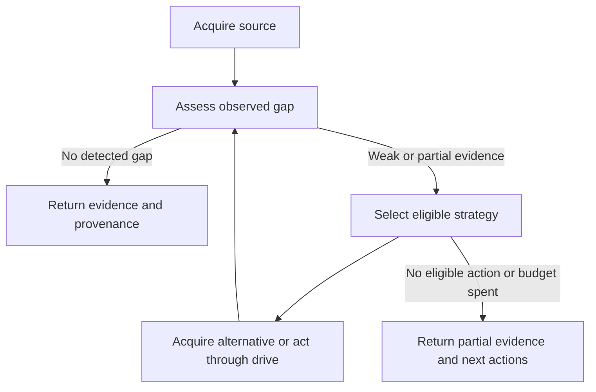

# Autonomous reading and recovery

An ordinary `fetch` acquires a source, assesses observable gaps, selects an eligible
recovery strategy, then reassesses the result. It returns evidence, provenance and a
decision trace. No model, paid API or extra key is needed. The caller still judges
whether the evidence supports its question.



## Browser evidence when HTML is capped

Large application pages can exhaust the HTML capture limit before reaching their
article or comments. A truncated headed capture now reads the same live page's
visible body text, preserving the original HTML provenance. The planner can also
use visible text when HTML is partial or yields little prose. This adds no new
browser engine or paid service. Visible text may include navigation, ads and
related material; warnings state this explicitly. A complete text snapshot does
not establish complete source coverage. `html_capture_partial` describes the HTML
capture independently from the visible text's `partial` flag.

The browser uses the same bounded navigation recovery as manual [drive](DRIVE.md).
The existing acquisition ladder selects it automatically when eligible; callers
can continue the returned scoped browser session for native interactions.

## What selects an action

| Observation | Eligible recovery |
|---|---|
| Failed, thin, suspect, navigation-only or partial source; no focus term matches | Consider publisher-declared alternatives and browser inspection |
| Same-origin declared Markdown at the same path | Read the representation and preserve requested/acquisition URLs |
| Same-origin declared JSON | Accept a primary `content.rendered` body only when `link` identifies the requested document |
| Navigation-only source not already rendered | Try the configured renderer |
| Important information in image/document assets | Try up to two supported assets with the original OCR policy |
| Browser still loading or `aria-busy=true` | Bounded loading wait and another observation |
| Visible unopened standard HTML details | Open up to two summaries without nested interactive controls, then read again |
| Scrollable page with an unresolved reading gap | Scroll 650 pixels once, wait briefly and reassess |
| Browser gap remains and a same-origin JSON response was observed | Inspect up to three eligible captured responses for an exact-document primary body |

The policy reads DOM state and declarative metadata; text on the page cannot supply
new operating instructions. It does not guess arbitrary selectors, click arbitrary
buttons, perform a login, solve an interactive CAPTCHA or replay application requests.
Custom controls and exports remain available to the agent through explicit `drive`.

An already failed/challenged headed attempt is not blindly repeated. HTTP errors and
recognized challenges in browser inspection cannot become clean successful reads.
oEmbed metadata, unrelated JSON, cross-origin alternatives, translated representations
and unadvertised print/AMP guesses are not automatically promoted into source evidence.
RSS/Atom declarations are exposed for deliberate reading; summaries are not treated as
the requested full article. Existing JSON-LD extraction remains part of the extractor.

## Read the decision trace

`read_plan` reports its revision, initial/final gap, strategy decisions, reasons,
timings, adoption outcomes, budget and stop reason. `answer_verified` remains false.
An adopted candidate ranks better on extraction availability, navigation/pollution
signals, focus term support and retained text size; that is not semantic correctness.
No detected gap does not establish full coverage. A short valid document can remain
`thin` and still contain useful evidence.

There are at most six strategy decisions. `DETHROTTLED_READ_PLAN_SECONDS` defaults to
30 seconds and is clamped to 0–120. It is an admission budget for additional recovery,
measured after the transport ladder. It does not forcibly cancel an already running
HTTP/parser operation; that operation retains its bounded transport timeout. Browser
observations have their own request deadlines. The initial ladder has separate limits.

`recovery="manual"` disables this higher-level planner while retaining the underlying
transport/format ladder. `render="never"` and the fast profile prohibit browser actions;
publisher alternatives can still be read over HTTP. Raw HTML and links modes bypass
the planner. Explicit OCR, page/row ranges and public-target restrictions are preserved.

## Identity and evidence

HTTP and TLS use separate process-local cookie sessions keyed by caller namespace,
exact origin, transport/profile and public-target policy. A bounded pool retains up to
64 identities, prunes inactive sessions after 30 minutes and serializes use of each jar.
Busy identities are not evicted. At capacity, new requests can use disposable sessions.
Off-origin redirects use a disposable client and cannot receive or populate the original
jar. Public redirects are validated before following. Restarting the core loses these
in-memory jars; browser checkpoints have their own documented retention.

TLS profile selection remains operator-controlled. The negative live profile sweep did
not justify default random rotation, and Chromium cookies are not copied into Firefox
or Safari TLS identities. Browser recovery reuses the existing caller/exact-host session
and attempts to checkpoint supported state when time remains. Reuse
`read_plan.browser_session.id` with its `allowed_hosts` in `drive` to continue that state.
These reserved `auto-read-…` handles are caller-scoped and work across REST and MCP.
Ordinary explicitly named sessions retain their transport-private isolation. Browser
state remains subject to idle expiry and checkpoint rules: an automatic read's page is
closed after five minutes unused (`DETHROTTLED_READ_SESSION_IDLE_SECONDS`), after
which the handle restores cookies and storage from its checkpoint but not the live page. Upgrading to this handle
scheme starts fresh automatic sessions; old checkpoints expire normally.

Recovered text is retained with its own document hash. `requested_url`, `acquisition_url`,
`representation_relationship`, parent references and `read_plan` describe its origin.
When recovery selects another view, `evidence_variants` links the retained original
extraction. The selected view can omit material found in that original; follow its
`read_document` action when needed. Focus and clipping operate after retention. Failed recovery preserves the best available
evidence and warnings. Acquisition provenance is not a claim of complete equivalence or
verified answers. [Agent integration](AGENT-UPGRADES.md) explains continuation and actions.

## Optional GPU acceleration

The base Compose setup remains usable without a GPU. On Linux Mesa hosts, use:

```sh
scripts/compose-auto.sh up -d --build
```

The host helper detects DRM nodes and exports their numeric render/card GIDs before
loading `docker-compose.gpu.yml`. Set `DETHROTTLED_GPU=off` to skip the overlay. Additional
Compose options, files, profiles and the command are forwarded. Existing `COMPOSE_FILE`
selection from the process environment or default project `.env` is preserved. Use the same helper for
later updates if you want automatic device selection preserved.

The worker's `auto` mode tries ANGLE GL EGL when a render device is exposed and verifies
the reported renderer plus a rendered pixel. Failed hardware verification falls back to
the established software path. `/v2/status` exposes the browser's active graphics result;
the private worker also reports it in `/health`. `mesa` retains the explicit software-
compatible GL configuration; `default` retains Chromium's original launch arguments.

This path was tested on AMD/Mesa and with no GPU devices. It is not a universal NVIDIA
configuration or evidence of defeating a particular anti-bot vendor. Software WebGL is
real rendering too. The [evidence index](EVIDENCE.md) distinguishes capability tests from
live access results.

[Documentation home](README.md) · [API](API.md) · [Browser operation](DRIVE.md)

Successfully acquired non-HTML documents use their format/range/OCR continuation
instead of HTML browser inspection. A remaining gap is reported as
`document_continuation_required`; consult `workflow.next_actions`. This does not
alter browser recovery for HTML challenge pages served at document-looking URLs.
See [long PDF limits](LIMITS.md#long-pdf-reads).

Malformed URLs and explicit public-network-policy refusals are terminal for the
current request. They do not enter browser recovery, and guidance does not suggest
retrying them through another transport. Redirect policy refusals retain their
specific reason and stop the acquisition ladder as `policy_blocked=network`.
Ordinary DNS/connect/TLS failures keep bounded recovery: a worker or another
transport can have a working route. There is no blanket two-second dead-host cutoff.
