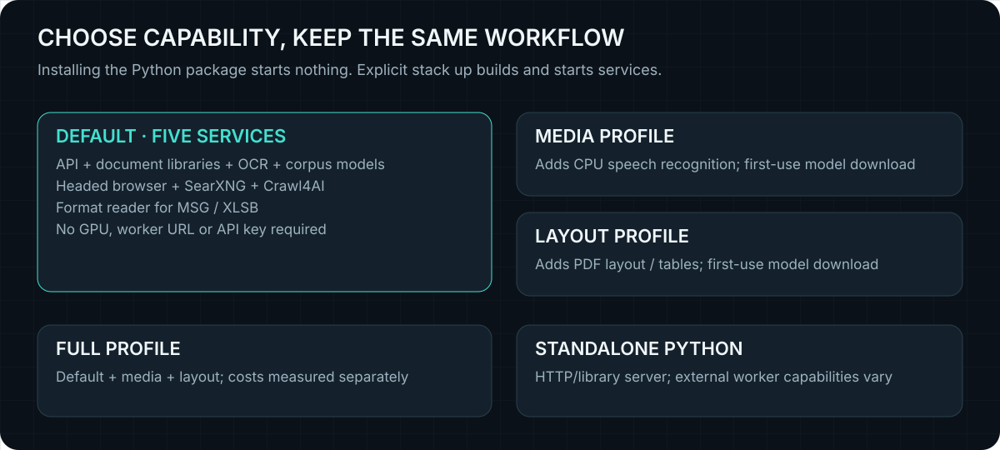

# Installation choices and measured requirements

Use the **managed stack** for the complete default engine. A Python-only install
is useful as a library or lightweight HTTP server, but Python extras cannot
supply Docker workers, Chromium, Tesseract or legacy system converters.

| Route | Prerequisites | Capabilities |
|---|---|---|
| `pip install dethrottled` then `dethrottled stack up` | Python 3.10+, running Linux Docker Engine and Compose plugin v2+; native AMD64 or ARM64 | Five default services, matching sources bundled in the distribution |
| GitHub clone then `docker compose up -d --build` | Git, Linux Docker Engine and Compose | Same five default services; checkout supplies deployment sources |
| Standalone `dethrottled` or direct library calls | Python 3.10+; optional libraries/system tools/workers as needed | Available features depend on what is installed and configured |

Docker Desktop must use Linux containers. Native Linux AMD64/ARM64 stacks were
measured; Windows/macOS **Python** CI is not a full Docker Desktop performance
evaluation. A GPU is optional. Default measurements use software rendering on
both devices. [GPU setup](READ-PLANNER.md) and dated GPU evidence remain separate.

Package installation starts no services and downloads no model weights. Explicit
startup downloads/builds images and acquires corpus weights during the API image
build. First use of speech/layout downloads their models into separate volumes.
Network access and free disk space are required for these steps. The CLI checks
Docker, Compose, platform and the requested port, reports host CPU/RAM, and never
installs system packages, elevates privileges or changes firewall settings.

## What the measurements establish

| Recorded default-stack workload | ARM64 edge device | x86_64 mini PC |
|---|---:|---:|
| CPU | 4 Cortex-A55 + 4 Cortex-A78 cores | Ryzen 7 5800U, 8 cores / 16 threads |
| RAM visible to the OS | 11.29 GiB | 30.76 GiB |
| Peak sampled container working set | 4.99 GiB | 6.63 GiB |
| Logical uncompressed Crawl4AI image alone | 10.08 GiB | 7.62 GiB |

These memory figures cover the default services during the recorded workload,
excluding other host processes. They are neither idle consumption nor a safe
total-RAM recommendation. Optional inference, concurrency and larger inputs add
cost. The renderer image is the largest individual default image; allow space
for the other images, builds and retained data as well.

The [1.4.0 two-device report](../evaluations/install-showcase/results/2026-11-04/REPORT.md)
records tested hardware, sampled working-set memory/CPU, image sizes, startup
and model initialization. Those are observed costs for a fixed workload,
**not universal minimum requirements**. Public source availability can change,
and ordinary services remained active on the hosts.

Docker image sizes are logical uncompressed sizes, not download sizes or additive
unique disk requirements. Shared layers, architecture, build cache, retained
source data, corpus growth and optional model caches change actual disk use.
A named volume surviving shutdown is expected; `stack down` does not reclaim it.

## Optional workers

<picture>
  
</picture>

| Profile | Adds | Resource policy |
|---|---|---|
| Default | API, headed browser, SearXNG, Crawl4AI, format worker | API/browser have no total Compose RAM cap; format worker capped at 2 GiB |
| `media` | CPU speech recognition | Faster-Whisper `small`, int8; 3 GiB container cap; persistent model cache |
| `layout` | PDF layout, OCR/table inference | Docling/CPU PyTorch; 8 GiB container cap, four CPUs; persistent model cache |
| `full` | Both optional inference workers | Combined workload and model/cache costs; not required for default readers |

Container caps are safety ceilings, not memory reservations or proven minima.
More concurrent pages, large workbooks, longer audio and corpus indexing can cost
more than these fixtures. Input/page/row limits and supervisor deadlines still
apply. Read [configuration](CONFIGURATION.md) before increasing them.

Selecting a different profile adds/updates its services; it does not remove
previously started optional services. To return to a precise smaller selection,
run `stack down`, then `stack up --profile default` (or `media`/`layout`). Data
and model volumes remain available across that cycle.

[Benchmark results](BENCHMARKS.md) · [Python installation](PYTHON.md) · [Operations](OPERATIONS.md)

## Corpus v2 resource budgets

The [Corpus v2 evaluation](../evaluations/corpus-v2/results/2026-11-05/REPORT.md)
measures normalized storage and real-model process memory separately. The default
256 MiB combined vector-matrix budget excludes model weights, tokenizer/ONNX
workspaces, Python and SQLite overhead; it is not an overall RAM cap. The paired
real-model development captures were approximately 1 GiB peak RSS. Full-source
indexing can increase storage and work for a fixed document collection, even
though normalized storage is smaller at matched vector counts. See
[Corpus operation](CORPUS.md) for the soft disk target, bounded cleanup and knobs.

The local [retrieval reliability candidate](../evaluations/retrieval-reliability/REPORT.md)
measures the additional extraction-only time and peak RSS for selective coverage
comparison on both architectures. These figures exclude embedding-model memory
and do not establish new universal minimum requirements. Final publication and deployment verification is recorded with the 1.5.2 release.

## Unreleased filtering overhead

The [adblock evaluation](../evaluations/adblock/README.md) separates per-process
list memory, startup parsing CPU and complete browser workloads. These are measured
additional costs for the recorded snapshot, not new universal machine minimums.
