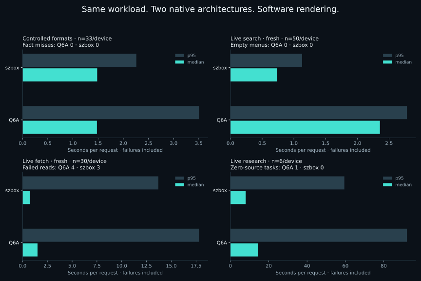
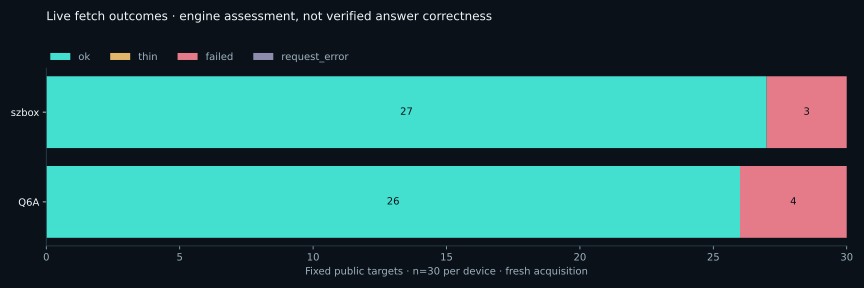
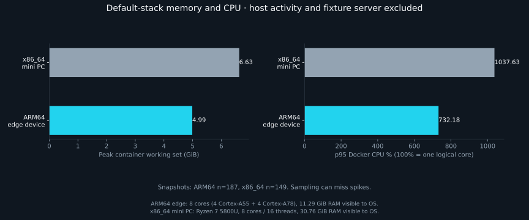

# Dethrottled 1.4.0: complete installation and two-device validation

Recorded 4 November 2026. Both native Linux hosts ran the same HTTP runtime source: 38 API modules and the two browser modules match byte-for-byte. The frozen comparison uses runtime commit `a69b5bc`; subsequent changes concern stack prerequisite/port diagnostics, documentation and evidence tooling. The workload manifest SHA-256 is `ca24518d44c26b9d75e881c03fd4bd92e6892ce38f8baab1ff09aa51facb0b10`.

The strongest result is reproducible local functionality: both machines passed 63/63 browser/document contracts, 3/3 worker-restart restores, 33/33 controlled format fact checks and 108/108 local concurrency fact checks. These are repeated mechanical and retention checks, not independent research questions or general accuracy scores. Real installation and browser failures were found, fixed or guarded, and retained in [the issue record](ISSUES.md).

Published-package and fresh-clone checks are recorded in the living [release verification record](https://github.com/halonyx-io/dethrottled/blob/main/evaluations/install-showcase/results/2026-11-04/PUBLICATION.md) after immutable artifact upload. This report separates candidate measurements from those publication checks.

## Hardware, isolation and method

| | ARM64 edge device | x86_64 mini PC |
|---|---|---|
| Device class / architecture | Edge board / ARM64 (aarch64) | Mini PC / x86_64 (AMD64) |
| CPU | four Cortex-A55 + four Cortex-A78 cores | Ryzen 7 5800U; eight cores / sixteen threads |
| OS / kernel | Ubuntu 24.04.5 / 6.18.2-3-qcom | Debian 13 / 6.12.111+deb13-amd64 |
| Docker / Compose | 29.9.3 / 5.7.0 | 29.8.2 / 5.6.0 |
| RAM visible to OS | 11.29 GiB | 30.76 GiB |

Each default stack used an isolated `dethrottled-benchmark` Compose project, fresh project volumes and loopback port 19087. Existing production remained untouched. Both browser workers used software rendering with no GPU device. The application source/workload/fixture bytes match; OS, kernel and Docker versions differ. Normal host services remained running. Docker on ARM64 edge device was newly installed through the official Ubuntu repository, but historical image data already existed. This is not a pristine image-download or idle-host comparison.

Eleven generated formats share an expected synthetic fact, “5120 megawatts”. Identical bytes were copied between devices and tested three times, including retained-document reads. Browser contracts exercise automatic JS recovery, lazy/details/network/cookie flows, scope, long reads, MSG/XLSB, frames, popups, downloads and four storage types across restart. Concurrency uses local fixtures at one, three and six callers: twelve requests per batch, three batches per level.

Live runs use 50 English search questions, 30 fixed URLs and six research tasks per machine. Fresh acquisition ran ARM64 edge device then x86_64 mini PC; cache-enabled repeats reversed order. Search starts were paced at least three seconds apart. Public sites were not used for concurrency bursts. Every outcome is retained. There is one fresh live cohort per device; differences cannot be attributed solely to hardware.

## Latency and delivered evidence

Client wall time, including failures; p95 is nearest-rank. “Warm” means cache-enabled repeat, not a guarantee of a cache hit.

| Workload | n/device | ARM64 edge device median / p95 | x86_64 mini PC median / p95 |
|---|---:|---:|---:|
| Controlled formats | 33 | 1.476 / 3.505 s | 1.482 / 2.260 s |
| Fresh search | 50 | 2.356 / 2.782 s | 0.733 / 1.129 s |
| Cache-enabled search | 50 | 0.722 / 1.117 s | 0.004 / 0.019 s |
| Fresh fetch | 30 | 1.511 / 17.804 s | 0.743 / 13.701 s |
| Cache-enabled fetch | 30 | 0.959 / 16.112 s | 0.646 / 7.932 s |
| Research | 6 | 14.480 / 92.106 s | 7.961 / 59.452 s |

<picture>
  
</picture>

| Outcome | ARM64 edge device | x86_64 mini PC |
|---|---:|---:|
| Nonempty fresh search menus / 50 | 50 | 50 |
| Fresh fetch `quality=ok` / 30 | 26 | 27 |
| Fresh fetch literal topic marker present / 30 | 24 | 25 |
| Research tasks with readable sources / 6 | 5 | 6 |
| Readable research sources returned | 20 | 24 |

Every search menu stayed within fifteen unique choices. Fresh rows reported no cache hits; the cache-enabled search repeats reported 604 cached rows on ARM64 edge device and 627 on x86_64 mini PC. Search delivery is not a relevance judgement. No new semantic labels or paid-provider comparison were collected in this hardware evaluation.

ARM64 edge device’s PostgreSQL EXPLAIN research task returned zero candidates and zero sources; it is preserved as a failure. Its battery-degradation task took 92 seconds and attempted eight reads before returning four readable sources. x86_64 mini PC returned four sources on every task. These bundles expose evidence and coverage gaps; neither the engine nor this benchmark verified the answers.

<picture>
  
</picture>

Live assertions mostly check topic words. The Docker service reference was truncated before `healthcheck` in its first 12,000 characters on both hosts. A separate retained-document focus read recovered that term on x86_64 mini PC in 17.5 ms without reacquisition; it does not change the frozen initial count. The example-domain page returned real multilingual publisher prose without our expected heading phrase. Its marker miss is retained. Brand words, `quality=ok` and HTTP 200 do not prove a hostile-source bypass.

### Per-target fresh fetch outcomes

`marker` means only the predefined literal check. “Missing” does not necessarily mean the source was absent: truncation and representation changes also matter.

| Target | ARM64 edge device quality / marker | x86_64 mini PC quality / marker |
|---|---|---|
| pathlib | ok / present | ok / present |
| asyncio | ok / present | ok / present |
| docker | ok / missing | ok / missing |
| postgres | ok / present | ok / present |
| caddy | ok / present | ok / present |
| rust | ok / present | ok / present |
| sqlite | ok / present | ok / present |
| http429 | ok / present | ok / present |
| unicode | ok / present | ok / present |
| bm25 | ok / present | ok / present |
| nasa | ok / present | ok / present |
| who | ok / present | ok / present |
| ipcc | ok / present | ok / present |
| gutenberg | ok / present | ok / present |
| fastapi | ok / present | ok / present |
| onnx | ok / present | ok / present |
| kubernetes | ok / present | ok / present |
| example | ok / missing | ok / missing |
| hn | ok / present | ok / present |
| github | ok / present | ok / present |
| reddit | ok / present | ok / present |
| oldreddit | failed / missing | failed / missing |
| booking | ok / present | ok / present |
| crunchbase | ok / present | ok / present |
| g2 | failed / missing | ok / present |
| bloomberg | failed / missing | failed / missing |
| wsj | failed / missing | failed / missing |
| pdf | ok / present | ok / present |
| csv | ok / present | ok / present |
| robots | ok / present | ok / present |

Old Reddit, Bloomberg and WSJ failed in both fresh cohorts; G2 failed on ARM64 edge device. Cache-enabled repeats differed, reinforcing that public-source access is changeable. Full attempts, warnings, partial/truncation flags and failure reasons remain in the case files.

## Working set, CPU and disk

| Sampled default stack | ARM64 edge device | x86_64 mini PC |
|---|---:|---:|
| Peak working set (GiB) | 4.99 | 6.63 |
| p95 reported CPU % | 732.18 | 1037.63 |
| Snapshot sets | 187 | 149 |

<picture>
  
</picture>

Docker stats estimates working-set memory; 100% CPU represents one logical core. Host services and the fixture server are excluded. Samples can miss spikes; CPU intervals are not exactly aligned between containers, so summed raw peaks can exceed instantaneous physical capacity. The chart uses p95 CPU, and raw samples/outliers remain available. Host load before/after every phase is in its summary. ARM64 edge device had 5.6 GiB swap; x86_64 mini PC had 7.7 GiB. These are observed costs, not universal minimum RAM requirements.

| Logical uncompressed image | ARM64 edge device | x86_64 mini PC |
|---|---:|---:|
| API | 2.00 GiB | 1.99 GiB |
| Browser | 1.41 GiB | 1.40 GiB |
| SearXNG | 0.35 GiB | 0.36 GiB |
| Crawl4AI | 10.08 GiB | 7.62 GiB |
| Formats | 0.61 GiB | 0.59 GiB |

Image sizes are not compressed download sizes and must not be added as unique disk use: layers can be shared. Build cache, corpus/documents and optional model volumes are additional. Recorded image inventory precedes final documentation-only bundle growth.

## Installation and optional profiles

Fresh ARM64 edge device core and `[all]` virtual environments installed the candidate wheel and read controlled HTML and PDF respectively. Wheel commands ran outside a checkout. Default, media, layout and full profile gates passed. A deliberately stopped format worker reported unavailable; a busy port was refused. Shutdown preserved volumes, and a retained document still supported its fact after restart. Full-profile status became ready after inference initialized both model caches. Installing the package starts no services.

First successful candidate `stack up` reports were 239.73 s on ARM64 edge device and 199.75 s on x86_64 mini PC, after failed attempts and with cached layers. They include build/startup work and are not clean installation-time comparisons. Exact later lifecycle command timings are retained in `installation/commands.json`.

| Optional inference | ARM64 edge device first / warm median | x86_64 mini PC first / warm median |
|---|---:|---:|
| media | 23.01 / 12.21 s | 26.14 / 4.37 s |
| layout | 34.22 / 18.15 s | 33.88 / 10.39 s |

Each worker used its actual inference path and retained the expected fact in four requests per device. Speech used an 11-second public JFK recording; layout used the fixed scanned PDF. First requests include model acquisition and initialization; warm requests still load a supervised child per job. Media model cache was about 464 MiB and layout about 506 MiB allocated disk on each host. These simple fixtures do not establish transcription accuracy or table fidelity for arbitrary sources. x86_64 mini PC media resource samples cover the warm jobs only; its cold timing is retained separately.

The separate x86_64 mini PC GPU feature probe verified AMD hardware rendering and passed three native frame-interaction checks. It was outside the default software cohort, did not test hostile sources and is not a GPU speedup claim.

## Evidence and reproduction

- [Protocol and commands](../../README.md), [frozen manifest](../../manifest.json).
- [Derived metrics](metrics.json), [export provenance](export-manifest.json), [checksums](checksums.json).
- Per-case results, summaries and resource snapshots retain stable capture IDs.
  [ARM64 device inventory](q6a-inventory.json) and
  [x86_64 device inventory](szbox-inventory.json) identify their architectures and specs.
- `optional/`: inference cases/resources and model-cache costs.
- `installation/`: readiness, profile selection, shutdown, retention and command results.
- `failures/` and [issue resolutions](ISSUES.md): original failures and diagnostics.
- `provenance/`: matching runtime source hashes, dependency inventories and candidate wheel hash.

Public search records retain URLs, titles, backend provenance, snippet lengths and snippet hashes; full original captures stay private. Snippet text is not republished, and private-range strings are redacted. Numerical measurements are unchanged. Full article bodies, credentials and browser login state are not published.

The [4 October report](../../../../docs/BENCHMARKS-2026-10-04.md) remains dated historical evidence, not a direct regression baseline for this different workload and deployment.
